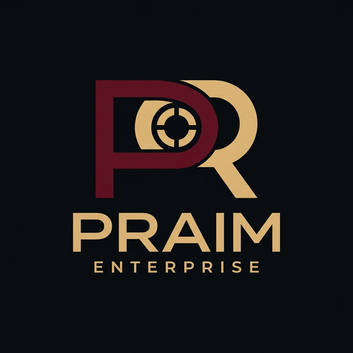
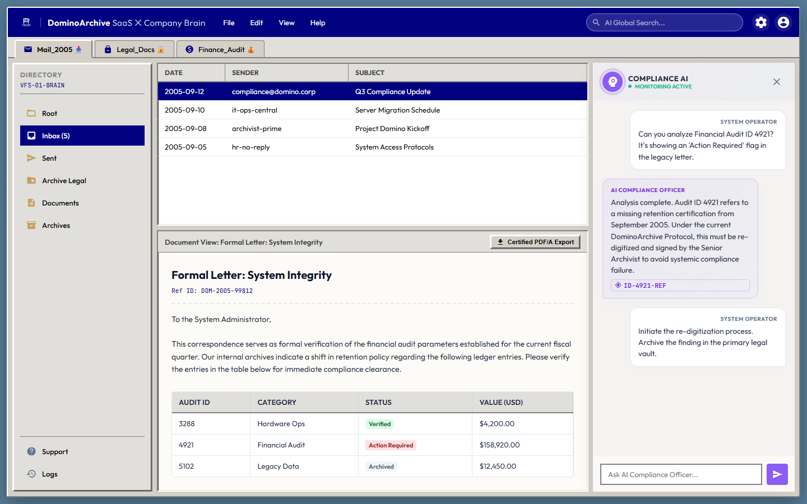

  

<h1 align="center">DominoArchive SaaS ✕ Company Brain</h1>

  <strong>AI-native compliance officer and archiver for legacy IBM Lotus Notes / Domino data.</strong>

  
  
  

Platform arsip untuk tim **Compliance & Legal korporat**. Banyak perusahaan masih bergantung pada server database Lotus Notes / Domino lama yang mahal dan sulit dipelihara. DominoArchive bertujuan melepaskan ketergantungan itu tanpa kehilangan akses ke arsip.

**[Coba demo interaktif](https://domino-archive.pages.dev)**

*Tangkapan layar prototipe. Semua data bersifat ilustratif.*

## Arah Produk: Company Brain

Konsep ini dirancang menjawab tema "Company Brain" pada YC Request for Startups Summer 2026 dan pernah diikutsertakan dalam kompetisi YC tersebut. DominoArchive tidak berhenti pada ekstraksi database `.nsf` lama menjadi tabel data statis. Arsip tidur puluhan tahun diubah menjadi **Company Brain**:

- **Zero-Touch Extraction**: pengurai berkas `.nsf` berbasis cloud yang mengekstrak dokumen, email, dan skema database lama secara otomatis.
- **Knowledge Structuring**: menyusun data mentah menjadi basis pengetahuan terstruktur (Knowledge Graph dan Vector Embeddings).
- **Autonomous Compliance Agent**: agen AI aktif yang memakai basis pengetahuan tersebut untuk menjawab pertanyaan audit, menjalankan pemeriksaan kepatuhan hukum (*legal-compliance checks*), dan menelusuri dokumen sejarah secara instan lewat bahasa alami.

Bagian ini menjelaskan arah produk. Fitur-fitur tersebut belum dirilis. DominoArchive tidak berafiliasi dengan Y Combinator.

## Yang Ada di Demo

- Antarmuka bergaya Lotus Notes klasik: bilah judul, tab ruang kerja, navigasi direktori, dan daftar dokumen.
- Pratinjau dokumen di panel terpisah, lengkap dengan tabel data audit dan tombol ekspor PDF/A tersertifikasi.
- Panel Compliance AI dengan percakapan dan kutipan yang tertaut ke dokumen sumber.

Demo memperagakan pengalaman yang dituju, dari menelusuri arsip sampai bertanya langsung kepada Compliance AI, dengan data ilustratif. Mesin ekstraksi dan AI yang sesungguhnya belum dirilis.

## Status

Rancangan dan prototipe statis (data ilustratif). Kode implementasi belum dirilis.

## Struktur Repositori

| Jalur | Isi |
|---|---|
| `proto/` | Prototipe antarmuka statis (HTML, CSS, JavaScript) |
| `docs/` | Aset dokumentasi (tangkapan layar) |
| `scripts/` | Pemasang hook pemindai rahasia (gitleaks) untuk clone lokal |
| `LICENSE`, `LICENSE.id.md` | Lisensi proprietary dan ringkasannya dalam Bahasa Indonesia |
| `SECURITY-NOTES.md` | Catatan praktik keamanan repositori |

Spesifikasi desain dan arsitektur lengkap tidak dipublikasikan di repositori ini.

## Keamanan

Repositori ini hanya memuat prototipe statis dengan data fiktif. Repositori dirancang tanpa kode implementasi, data pelanggan, maupun kredensial. Lihat [SECURITY-NOTES.md](SECURITY-NOTES.md).

## Lisensi

Hak cipta © 2026 Praim Enterprise (darimakassar/Mashuri Mashar). Seluruh hak dilindungi.

Perangkat lunak ini proprietary: lihat [LICENSE](LICENSE) (teks utama, Bahasa Inggris) dan [ringkasan Indonesia](LICENSE.id.md). Anda boleh melihat dan melakukan fork repositori ini di GitHub sesuai Ketentuan Layanan GitHub. Penggunaan lain, termasuk menyalin kode, desain, atau merek, memerlukan izin tertulis.

## Kontak

Permohonan izin dan kerja sama: Threads `@praimenterprise` atau TikTok `@praimenterpriseofficial`.
